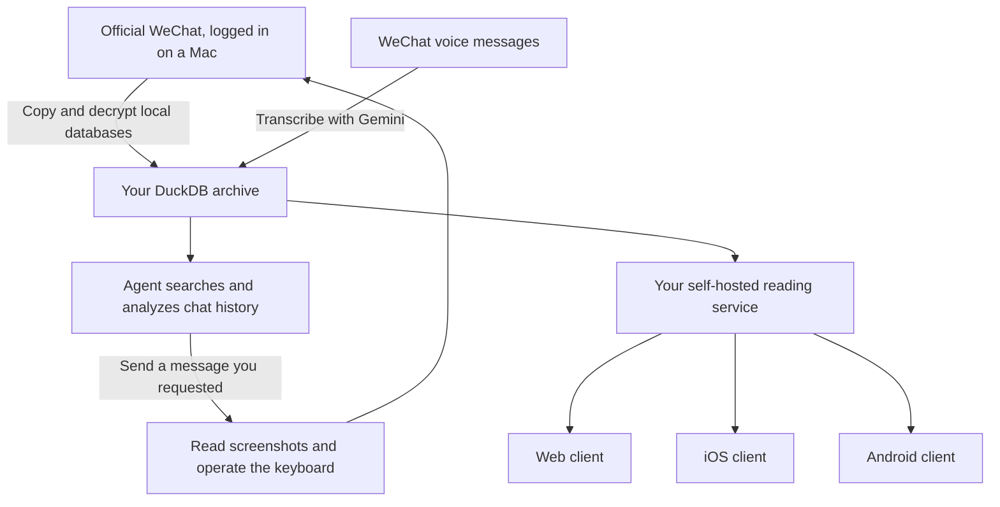

# How to Build Your Own All-Powerful WeChat Agent

**English** | [简体中文](README.zh-CN.md)

## Why have a WeChat agent?

Here are three things you can ask it to do.

**First, find someone and send a message.**

> Find the person I talked to about WeChat automation today. Tell them: it works now, and this message was sent by my agent.

The agent checks today's conversations, identifies the person, opens WeChat, finds the contact, and sends the message. You say who you mean and what you want to say; it handles the steps.

**Second, find something in your chat history.**

> Someone recommended an open-source project last month. I think it was related to voice. Find the message and the link.

You don't have to remember the group, the sender, or the exact wording. The agent can follow the clues you remember and retrieve the messages with their context. Once voice messages are transcribed, it can search those too.

**Third, bring together what people have said across different groups.**

> What have A and B been talking about in this group? Check what they've said in other groups too. Have they discussed the same project?

The agent can start with their messages in the current group, then look for their posts in other groups: what each person said, when they said it, and where they discussed a topic with each other. It can organize the findings by person, topic, and time, with the original messages for you to check.

In principle, it can search across all those groups once their records are in your local archive. You don't have to open each group and scroll through it. This covers **records your own account can see and has saved**, not other people's private conversations or groups you haven't joined.

You can go one step further: build your own client for this data, and read the same WeChat history on the web, an iPhone, or an Android device. We'll get to that below.

## How the system fits together

Keep the official WeChat app logged in on a Mac. Put the messages it receives into a local database for your agent to query. When you want to send a message, let the agent operate WeChat on that Mac. Add a service in front of your archive, and you can build your own web, iOS, and Android clients.

The overall structure looks like this:



**Official WeChat sends and receives. Your database stores the records. Your agent queries and acts. Your clients display the data.** Build those pieces in that order.

## 1. Keep WeChat logged in on a Mac

Log in to your own WeChat account on the Mac, keep it connected, and prevent the machine from sleeping while the system is in use. Both synchronization and sending depend on it. A dedicated machine helps, since operating WeChat may require bringing its window to the foreground.

You'll also need a coding agent that can read local files, run commands, and inspect screenshots. We use Codex. It can install dependencies, write code, compile the tools, and set up the service. You'll still need to handle the initial login and permissions that macOS asks you to grant.

**Record your versions before you start.** A WeChat update can change the databases or the way keys are obtained. These are the combinations we tested:

| Task | macOS | WeChat |
| --- | --- | --- |
| Initial successful key capture and decryption | 26.6.2, Apple Silicon | 4.1.13, build 269579 |
| Later screenshot, contact search, and sending tests | 27.0, build 26A428, Apple Silicon | 4.1.15, build 270102 |

These are test records, not versions you must install. Have your agent inspect your environment and find a matching approach.

**A useful trick for keeping the version stable:** consider installing [WeChat from the Mac App Store](https://apps.apple.com/us/app/wechat/id836500024?mt=12), then turning off **Automatic Updates** under **App Store → Settings**. You can choose when to update instead of having an App Store update change a working setup unexpectedly. [Apple's instructions](https://support.apple.com/en-us/102629)

That setting applies to all App Store apps, not just WeChat. It controls App Store updates; it doesn't guarantee that an old WeChat version will remain usable forever. Check the installed build and tool compatibility before updating, and back up your archive first. We're suggesting this as a way to make updates more predictable, not claiming that the App Store build has passed every test above.

Also, **the history you want to read needs to be on the Mac first.** Use WeChat's own migration or synchronization features to bring over records that exist only on your phone. Decryption can read local data; it cannot recover messages or attachments that were never downloaded.

## 2. Decrypt the local WeChat databases

WeChat stores local data under your account directory. A common location for WeChat 4.x on macOS is:

```text
~/Library/Containers/com.tencent.xinWeChat/Data/Documents/
  xwechat_files/<your-account-directory>/db_storage/
```

There are many databases here. Messages, contacts, sessions, media, and favorites live in separate files. Large message histories may also span several database files.

Ask your agent to locate your account directory, list the databases, and make copies before doing anything else. Include the accompanying WAL files: they may contain recently received messages that haven't yet been written back to the main database file. **Leave the original databases untouched.**

Next, obtain the keys. We referred to [wechat-chat-history-mac](https://github.com/BIBOYANG425/wechat-chat-history-mac) and [wechat4-macos-frida-export](https://github.com/TimFang4162/wechat4-macos-frida-export), then integrated key capture, decryption, and validation into our own program.

This is the most version-sensitive step. Have your agent read the upstream README, recent commits, and issues for successful tests matching your WeChat version. Maintainers update their tools, but support for every new release isn't immediate or guaranteed.

One issue we encountered was SIP, macOS System Integrity Protection. With SIP enabled, Frida could not attach to WeChat using either ordinary or administrator privileges. We captured the keys after SIP was disabled. **That SIP change was for key capture. Once you have validated keys, offline decryption of database copies does not require attaching to WeChat again.**

The upstream project later documented a separate debug-copy approach that keeps SIP enabled. We have not reproduced that route locally; it involves running a WeChat copy and logging in separately, so read its instructions first. Disabling SIP should not be treated as a mandatory step for every version. See the [verification notes](docs/verification.md) for the recorded versions and history.

Cache validated keys locally. On later synchronizations, reuse them and capture new ones only when a key is missing or fails validation. Different databases may use different keys, and a file at the same path can be replaced, so always validate against the actual data.

At the end, ask the agent to report which databases were decrypted, which are missing keys, and which failed integrity checks. If the main message databases are readable, you can proceed with the chat archive while keeping track of the remaining gaps.

## 3. Import into DuckDB and turn voice into text

The decrypted databases still use WeChat's own schema. Add an import step that organizes the records in a local **DuckDB** database. That makes subsequent queries much simpler.

For every message, keep at least the sender, conversation, timestamp, message type, body, and original message ID. For contacts, keep remarks, nicknames, and WeChat IDs so the agent can distinguish people with the same display name.

Deduplicate imports by message identity. Later, synchronize new messages instead of importing the entire history again. The sync command runs once and exits.

**Once manual synchronization works, set it to run every hour.** You can ask your local Codex or Claude to configure a task with the Mac's scheduler:

> Set up a local task that synchronizes my WeChat archive every hour. Check the available message databases, import new or changed records, and reuse validated keys. If my reading service is running, update its data afterward. Prevent overlapping runs and keep a log of the last successful sync and any failures.

The scheduler can run the script directly; it doesn't need to call a model every hour or keep your agent conversation open. The Mac must be awake and your user session logged in, and WeChat must remain connected to receive new messages. Missing keys should produce an error record rather than an unattended permission prompt. Schedule voice transcription separately if you want it, since that calls Gemini.

### Handling voice messages

Extract the audio from the media databases, send it to Gemini for transcription, and store the text in DuckDB. [WeChatDecrypted](https://github.com/kclx/WeChatDecrypted) is a useful reference for voice data handling. We use pilk for SILK audio and ffmpeg for some other formats.

Keep the audio files in a local directory. Store their paths, transcripts, and message associations in the database.

**Transcription must preserve who said it and when.** If a voice message becomes “See you Friday at 3 p.m.,” it must still point to the original sender, conversation, and timestamp. Otherwise, the agent cannot tell who arranged the meeting or which Friday they meant.

Start with ten messages, check the text and its association with the original messages, then process the rest. Save successful results so subsequent searches don't call Gemini again. Choose an audio model available to your API project; consult the [Gemini audio documentation](https://ai.google.dev/gemini-api/docs/audio). This step sends the audio to Gemini.

### Images, favorites, and articles

For images, first obtain the files. We can currently read ordinary image files and some older encrypted formats. Newer encrypted images are not handled comprehensively, and we haven't added batch OCR. Once an image is readable, an agent can inspect it on demand; you can then associate the extracted information with its original message.

Favorites have their own database too. We have decrypted the main favorites database, but haven't fully integrated it into the query tools. Listing favorites and organizing their links and attachments are further steps.

Official Account articles often need another step. A chat record may contain only a title, link, or shared card. Once you have the link, a browser agent can try opening and reading the article. Having a shared link in the database doesn't mean the full article has been archived.

You now have a local WeChat archive that can be updated over time. Back up DuckDB, media files, and keys to a private, secure location. Keep them out of public source repositories.

## 4. Let the agent query your history

Give the agent a small set of query commands and package the workflow as a skill: update the archive, identify the contact or group, retrieve messages by date and keyword, and read surrounding messages when needed.

Then you can ask:

> What's on my schedule next week? Separate confirmed plans from tentative ones.

> Who regularly contributes useful information in my AI groups? Show me examples.

> Have this person in group A and that person in group B mentioned the same project? What might their connection be?

You don't necessarily need a vector database. We started with DuckDB queries for people, dates, and keywords, followed by the agent reading the relevant context. That already handles many questions.

Two things matter: verify contacts with matching names, and separate what the messages explicitly say from what the agent infers. Answers should include dates and supporting excerpts so you can check them.

The database and queries run locally. If you use a cloud-based agent, retrieved excerpts may still enter the model's context. Query only the information you're comfortable sharing with that model.

## 5. Let the agent send messages

Sending uses desktop interaction. We wrote two small Swift programs: one captures WeChat through ScreenCaptureKit, and the other sends keyboard events to WeChat.

The agent combines them into roughly the same steps you'd take yourself:

```text
Bring WeChat to the foreground
  → Open search and enter a contact's name
  → Inspect the results and select the right person
  → Open the conversation and verify its title and context
  → Type the message and check the text
  → Press Return, then check for the new message
```

The agent decides what to do next from the screenshots. The Swift tools provide basic actions: capture, search shortcuts, typing, Return, and arrow keys. Changing the contact or message doesn't require rewriting the code. Adding a new action, such as a mouse click or scrolling, requires extending the tools.

This part is available in the repository as the [wechat-desktop skill](skills/wechat-desktop/SKILL.md), including Swift source and a build script. Have your agent read the skill and follow the [setup instructions](skills/wechat-desktop/references/setup.md).

Initially, you need two macOS permissions: **Screen Recording** to capture WeChat, and **Accessibility** to send keyboard events. These serve different purposes from the SIP issue during key capture. We didn't change SIP during the sending tests, but SIP was still disabled on the test machine. We haven't separately tested the complete sending workflow with SIP enabled.

Two practical issues are worth remembering.

The first is focus. Sending a shortcut to WeChat in the background didn't produce a verifiable change in the search box. Bringing WeChat to the foreground made the workflow work. The current approach needs an interactive desktop; don't assume it will also work while locked, asleep, or without a display.

The second is capture scope. Capturing only the main WeChat window can miss the search dropdown because it belongs to another window. The tool therefore also captures the app's windows together. An earlier blank-screen problem did not recur in later tests, so we can't simply conclude that WeChat blocks screenshots.

Start by sending a test message to yourself. Once that works, try a user-requested message to a specific contact. We completed both kinds of test.

Keep three checks in the workflow: **the right recipient, the right text, and a visible result after sending.** Don't overwrite an existing draft. If you can't tell whether a message was sent, investigate before sending it again.

## 6. The coolest part: build your own WeChat client

Now you have your own message database. Put a service in front of it, and you can read your chat history on any device that can reach that service.

We chose the open-source chat project [Tinode](https://github.com/tinode/chat). It already provides a server and chat interface, saving us from writing login screens, conversation lists, and message lists from scratch. Connect the archive to it, then make the interface your own.

Build this in three steps.

### Get the web client working first

Keep DuckDB as the archive, and import the data you want to display into the PostgreSQL database used by Tinode:

```text
WeChat history in DuckDB
  → Import into a separate display database
  → Tinode server
  → Chat interface in your browser
```

Each WeChat conversation becomes an archived conversation, preserving the original senders and timestamps. Transcribed voice messages appear as readable text.

Start with a read-only client: login, find a conversation, and browse its history. Remove the composer and have the server reject message writes too. That's the scope of our current client. Original image attachments and audio playback aren't integrated yet.

The update path is straightforward: WeChat on the Mac receives a message, the archive sync imports it into DuckDB, then another import updates the reading service. The clients display that copy, so freshness depends on how you run synchronization.

### Give it your own address

We use Tailscale. Add the Mac and your phone to the same private network, then expose the local reading service through Tailscale Serve with an HTTPS address your phone can open.

This lets you start without exposing the chat service to the public internet. Set your own login credentials and configure your clients with your own address. If the Mac shuts down, sleeps, or stops the service, remote access stops too. See the [Tailscale Serve instructions](https://tailscale.com/kb/1242/tailscale-serve).

### Turn it into iOS and Android apps

Once the web version works, use Capacitor to package the same interface for iOS and Android. All three clients share the backend and most of the interface code.

For Android, start with a test APK. For iOS, use your own Apple developer account, register an App ID, create an App Store Connect record, configure signing, and upload to TestFlight. Your agent can help with certificates and uploads; you'll handle any required account authorization.

We have built an Android test package, tested login, opening conversations, and scrolling in iOS and Android simulators, and uploaded the iOS version to private TestFlight testing.

**These apps log in to your service. They don't each use another official WeChat login slot.** The official app on the Mac continues receiving messages, while your other phones, tablets, and computers read the same archive through your clients. The number of devices is mainly a question of your service's capacity and access settings.

You also control the interface. Display voice messages as text. Build a page for a few selected groups. Add a “summarize the last week” button beside a conversation. Those further features can all use the same database; you don't have to solve data access again each time.

Sending directly from your own app needs one more connection: route a client request to the Mac's desktop tools, then handle the recipient, task queue, and result. **We haven't connected that part yet: the custom clients are read-only, and the agent sends through WeChat on the Mac.** Both sides work separately. The next step is connecting them reliably, especially avoiding duplicate messages when a request times out and gets retried.

## Where to start

Give this article and repository to your agent. First, have it check your machine and WeChat version. Work through the pieces in order: local archive, queries, desktop sending, then your own clients. Verify each step before moving on.

The repository currently includes the independently installable [desktop skill and Swift tools](skills/wechat-desktop/SKILL.md). The archive, reading service, and mobile clients have run in our local prototype; their reusable source packages are still being prepared and are not included here yet.

The supporting documents below are currently in Chinese; the self-contained skill can also be read by your coding agent.

- [Install the desktop skill](skills/wechat-desktop/references/setup.md)
- [Step-by-step prompts for your agent](docs/agent-prompts.md)
- [Prototype commands, dependencies, and data handling](docs/prototype-workflow.md)
- [Tested versions, SIP history, and verification scope](docs/verification.md)
- [Source release plan](docs/source-plan.md)

Happy Hacking!
