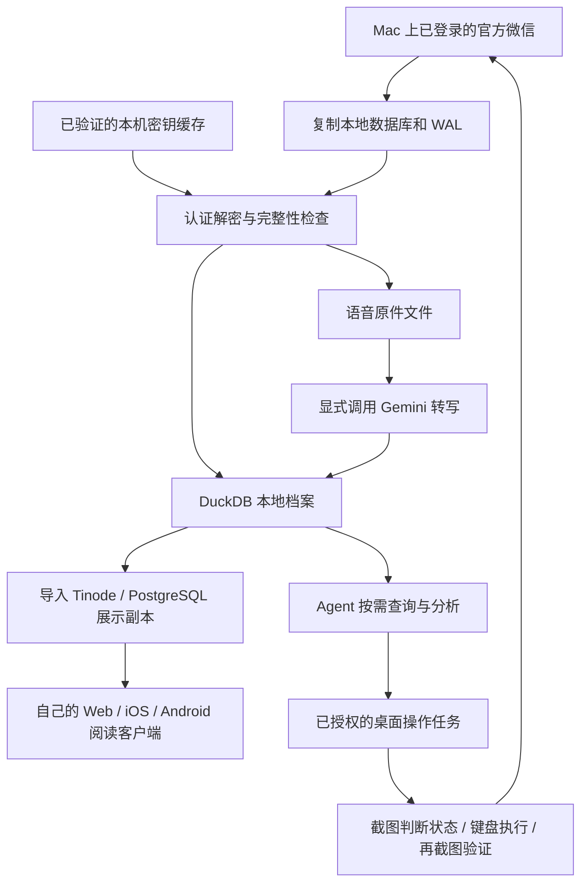

# 怎么样拥有一个你自己的微信 Agent

让一台保持登录的 Mac 接收微信，把本地消息整理成自己的数据库，让 Agent 帮你查资料、操作微信，再把历史记录带到自己的 Web、iOS 和 Android 客户端。

这篇文章来自一次实际搭建。我们先解决了“让 Agent 读懂我的微信”，再跑通了“让 Agent 在微信里发一条消息”，最后有了一个可以在多个设备上阅读历史的客户端。整个过程主要由 coding agent 完成：人提出需求、完成必要的系统授权和登录，Agent 写代码、检查结果、继续往下做。

你不需要先成为微信逆向工程师。你需要理解系统由哪些部分组成，以及怎样判断 Agent 真的把事情做成了。

> **当前发布范围，2026-10-09：** 完整教程，以及可安装的 [wechat-desktop Skill](skills/wechat-desktop/SKILL.md)、Swift 源码和构建入口。档案、服务端和移动端的通用化源码尚待一起检查后合入；下文对应的 Python/客户端命令来自运行中的原型，不是本次仓库现成的命令。已实测与未完成的部分见[验证记录](docs/verification.md)，源码整理见[配套文件计划](docs/source-plan.md)。

## 先安装桌面操作 Skill

如果你现在只想让 Agent 找人、发消息，可以独立使用这个 Skill，不需要先解密数据库或部署服务：

```sh
git clone https://github.com/ReByteAI/wechat-agent.git
cd wechat-agent
mkdir -p "$HOME/.codex/skills"
# 目标已存在时先比较，不覆盖已有 Skill。
test ! -e "$HOME/.codex/skills/wechat-desktop" && \
  cp -R skills/wechat-desktop "$HOME/.codex/skills/wechat-desktop"
cd "$HOME/.codex/skills/wechat-desktop"
python3 scripts/wechat_ui.py build
python3 scripts/wechat_ui.py status
```

按照 [权限说明](skills/wechat-desktop/references/setup.md) 完成首次授权，然后在能发现该 Skill 的 Agent 会话里说：“使用 wechat-desktop，给我自己的联系人发一条自动化测试消息。允许把微信切到前台。”

其他支持文件型 Skill 的 Agent 也可以读取整个 `skills/wechat-desktop/`；安装位置按其约定调整。源码和工具均自包含，截图及临时消息默认存到仓库外的本机私有目录。

## 从一台一直在线的 Mac 开始

微信里的信息很有价值，但通常被锁在聊天界面里。你可以搜一个关键词，却很难一次回答这样的问题：过去几周有哪些约定？某个群是谁持续提供有用信息？两个不同群里的人是否提过同一个项目？几个月前那条语音究竟说了什么？

另一个问题是设备。这里设想的日常组合是手机、平板（例如 iPad）和一台电脑；iPhone 本身就是手机这一类。微信的可同时登录组合受客户端版本和账号状态影响，本文不把“任何账号固定可以同时登录三端”作为前提，也不依赖这个数量。

我们的起点只有一个：**让一台 Mac 上的官方微信保持登录、联网，持续接收消息。** 可以用一台专门留在家里或办公室的 Mac。运行期间要避免整机休眠和网络中断；“保持登录”也不意味着永远不会过期，仍需处理重新登录和客户端升级。

这台 Mac 同时承担两个角色：消息进入你自己的系统的入口，以及后面执行桌面操作的机器。新增的阅读客户端连接你自己的服务，微信账号仍由这台 Mac 上的官方客户端登录。

这里先讲清楚一个范围：Mac 本地有什么，我们才能处理什么。手机独有的旧记录、没有同步或下载的附件，不会因为解密就自动出现。想覆盖更多历史，需要先通过微信提供的迁移、同步等能力把相应记录带到电脑，再检查实际覆盖。

## 你需要准备什么

版本非常重要。下面是这次实测环境，**不是最低版本承诺，也不是所有版本的兼容列表**。

| 部分 | 本次记录 |
| --- | --- |
| 电脑 | Apple Silicon Mac |
| 最早取钥、解密成功 | macOS 26.6.2；微信 4.1.13，build 269579；2026-09-16 |
| 当前截图、键盘发送 | macOS 27.0，build 26A428；微信 4.1.15，build 270102；2026-10-09 |
| Swift 工具 | Apple Swift 6.4；Xcode 27.0 |
| Python 档案 | Python 3.12+、uv；Frida 固定 17.18.0，pilk 固定 0.2.4；其他版本由锁文件固定 |
| 阅读服务 | Docker；Tinode 服务端及 Web 0.25.3；PostgreSQL |
| 手机客户端 | Capacitor 8.5.3；原型要求 Node 22+、Xcode 26+；Android 使用 JDK 21、SDK 36 |
| 可选外部能力 | Gemini API（语音转写）；Tailscale（自己的设备远程访问）；Apple 开发者账号（TestFlight） |

还需要一个能访问本地文件、运行命令和查看图片的 coding agent。我们使用 Codex。构建和配置可以交给 Agent，首次微信登录、操作系统要求的授权、Apple 账号操作中必须由人完成的步骤，仍要由你处理。

建议第一句话这样说：

> 按这个教程检查我的 Mac 和微信版本。先列出版本、权限和本机数据目录，再给我一份适用于当前机器的执行计划。先做只读档案，再测试给我自己发消息。不要把我的聊天、密钥或配置提交到 GitHub。

## 先看整个结构



读历史、操纵官方微信、提供自己的客户端，是三个可以分别验证的部分。读历史主要依赖数据库；发消息依赖桌面界面；多端阅读依赖你自己的服务。当前移动客户端只有阅读能力，还没有把 Mac 的发送动作接成远程发送接口。

## 第一部分：把微信变成自己的可查询数据库

### 第一步：确认数据在哪，先做副本

Mac 微信 4.x 的本机账号数据通常位于下面的目录结构，实际路径让 Agent 在你的机器上确认：

```text
~/Library/Containers/com.tencent.xinWeChat/Data/Documents/
  xwechat_files/<你的账号目录>/db_storage/
    contact/
    message/
    session/
    favorite/
    ...
```

微信不是只有一个数据库。消息会分片保存，联系人、会话、媒体、收藏等也有自己的文件。数据库文件旁还可能有 WAL，即尚未全部写回主文件的已提交事务。

原型先复制每个数据库及其 WAL，检查复制期间源文件是否变化；变化时重试，再对副本解密。不能只复制一个 `.db` 文件就声称拿到了最新消息，也不能直接对运行中的原库做修改。每个库的副本都有自己的时间点；这不是跨全部数据库的同一事务快照。

这一步的输出应该是一份可核对的清单：发现了哪些文件、哪些复制成功、哪些发生变化、快照什么时候生成。

### 第二步：获取并验证数据库密钥

“微信正在运行”和“我能读出密钥”是两件事。程序虽然需要解密自己的数据库，macOS 仍会限制其他进程读取它。

我们最早研究了 [BIBOYANG425/wechat-chat-history-mac](https://github.com/BIBOYANG425/wechat-chat-history-mac)，随后参考 [TimFang4162/wechat4-macos-frida-export](https://github.com/TimFang4162/wechat4-macos-frida-export) 的参数与取钥思路，编写了受限的 Frida 捕获和离线校验代码。语音库结构还参考了 [kclx/WeChatDecrypted](https://github.com/kclx/WeChatDecrypted)。这些是有来源的技术参考，不应把它们统称为同一个一键工具。

这类适配随微信版本演进。实践上，让 Agent 先检查上游 README、提交和 Issues，找与你的系统、CPU 和微信构建匹配的记录，固定采用的提交，再实际测试。**上游在更新，不意味着下一版一定能解开所有数据库。** 当前版本遇到问题时，应保留原件和已验证密钥，记录缺口，等待或研究适配。

#### SIP、管理员权限与发消息：这次到底发生了什么

我们当时是**关闭 SIP 来解决取钥时的进程访问问题**。

2026-09-16 的本机记录显示：SIP 开启时，普通用户和管理员两次 Frida 附加均失败；SIP 关闭并经管理员授权后，成功捕获密钥，并完成了主消息、联系人和会话库的解密校验。这个条件影响的是“从运行中的微信取得密钥”；已经拿到并验证过的密钥，之后可以用于离线解密副本。

后来截图、搜索联系人和发送消息使用的是另一组能力：ScreenCaptureKit 获取画面，辅助功能授权后的工具投递键盘事件。那次测试没有调整 SIP。**不过当时机器的 SIP 仍为关闭状态，所以我们没有单独验证 SIP 开启时的发送结果。** 不能把“使用的是辅助功能 API”写成“我们已经在 SIP 开启的机器上跑通过”。

| 权限或机制 | 在这个方案里的作用 |
| --- | --- |
| 文件访问 / 必要时完全磁盘访问 | 读取自己账号的微信容器和数据库副本 |
| 管理员授权 | 允许受限取钥工具以所需权限执行；不等于一定能附加微信 |
| SIP、目标进程保护 | 可能阻止外部工具附加进程；这是取钥适配要处理的问题 |
| 屏幕录制 | 获取微信窗口画面 |
| 辅助功能 | 向微信发送键盘事件 |

上游现在也有不同路线：截至本文核查的提交 `712bc9637f948ac1eedce73ff585e6d3d672fa06`，TimFang 项目描述了 SIP 开启时使用独立调试副本的方案。**这是上游报告的能力，我们没有在本机复现。** 它会创建调试副本，并涉及退出官方微信、运行副本和独立登录，不是本教程现有 `refresh` 命令的透明替代。执行前要看清生命周期和数据目录，不能直接混用。[上游固定版本说明](https://github.com/TimFang4162/wechat4-macos-frida-export/tree/712bc9637f948ac1eedce73ff585e6d3d672fa06)

本教程不提供自动关闭 SIP 或自动重签官方微信的安装步骤。Agent 应先报告当前方法需要的条件，再由用户决定采用哪条取钥路径。

### 第三步：密钥缓存下来，每次同步先验证

不要每次查聊天都重新抓密钥。原型把验证通过的密钥保存在账号隔离的本地 `data/keyring.json` 中，文件权限为 `0600`。候选密钥必须通过目标数据库首页 HMAC 校验后才进入缓存。

密钥不是按文件名永远绑定，也不能假定全部数据库共用一把密钥。微信升级不一定换钥；同一个路径下的库也可能被重建或替换。所以正确做法是：复用缓存，但每次用数据本身验证；只有缺失或失效时再尝试捕获。

解密后仍要逐页认证、正确处理已提交 WAL，并做 SQLite `integrity_check`。区分下面几种结果很重要：

- `verified`：通过解密和完整性检查。
- `missing_key`：没有能验证的密钥。
- `snapshot_failed`：副本不满足要求。
- `decrypt_failed`：解密或页认证失败。
- `integrity_failed`：解密后数据库逻辑校验没通过，不能简单归因于密钥错误。

原型当前命令如下，通用化源码合入后可在仓库根目录运行：

```sh
# 复用已有密钥，检查并恢复本机库。
./skill/scripts/wechat refresh

# 缺钥时才显式尝试捕获；先满足选定方法的进程访问条件。
./skill/scripts/wechat refresh --capture

# 没有安装专用工具、且需要单次管理员授权时。
./skill/scripts/wechat refresh --capture --admin

# 日常同步：执行一次就退出，不安装定时任务。
./skill/scripts/wechat sync
./skill/scripts/wechat status
```

原型还做过一个限定账号和固定入口的管理员取钥 helper，用来减少反复授权。它解决的是授权交互，不会自动解决 SIP 或微信版本兼容。第一次搭建可以先用单次授权，等流程稳定后再考虑它。

### 第四步：把已读取的消息整理进 DuckDB

这里用的是 **DuckDB**，不是 DarkDB。

微信原库保持不动；解密副本供校验和导入；DuckDB 保存方便查询的统一档案。每条消息不仅有正文，还保留发送者、会话、时间、类型、原始消息标识，以及来源分片和表等信息。

```text
data/
  archive.duckdb       消息、联系人、来源、处理状态、转写文字
  keyring.json         当前账号的已验证密钥，只留本机
  recovery-runs/       每次恢复的明文副本和逐库结果
  objects/            图片、语音等独立文件
  voice-results/      语音请求结果与恢复回执
```

导入按消息标识去重，修改前的内容保留版本；同步使用独占锁，查询使用共享锁和只读连接。日常查记录不需要生成 embedding，也不需要向量数据库。先把人、时间和上下文保真，Agent 就已经能做很多事情。

**数据库文件不是“所有微信信息齐全”的证明。** 应同时报告最新消息时间、最近同步时间、源库错误，以及语音和附件的覆盖率。本机成功导入了百万级消息，但仍有未拿到密钥或未通过完整性校验的辅助库。

### 第五步：把语音变成能搜索的文字

语音可以进入同一个问答体系，但要保留它属于哪条消息。

原型从通过校验的媒体数据库提取音频，按会话、时间和消息标识准确关联；匹配冲突就记录问题，不猜。SILK 音频通过 pilk 解码，其他部分格式需要 ffmpeg。音频原件和 WAV 保存在文件系统里，**不是把全部音频 binary 塞进 DuckDB**。

然后，显式调用 Gemini 做转写，再把文字、使用的模型、任务状态和音频哈希写入 DuckDB 的独立表。原消息正文不覆盖；查询视图把原消息与转写关联起来，能继续回答“谁在什么时间、哪个聊天里说了这句话”。

```sh
./skill/scripts/wechat sync
./skill/scripts/wechat voice extract
./skill/scripts/wechat voice status

# 先验证少量音频。文件中保存你自己的 Gemini API key。
# 请把 <支持音频输入的模型> 替换为你的项目当前可用的模型。
./skill/scripts/wechat voice transcribe \
  --key-file /absolute/path/to/private-gemini-key \
  --model '<支持音频输入的模型>' --limit 10

# 小批量核对成功后，去掉 --limit 处理其余已提取的待办语音。
```

API 模型的名称和可用性会变化，按 [Gemini 音频文档](https://ai.google.dev/gemini-api/docs/audio) 与自己的项目验证。普通音频模型走 generateContent；原型还包含专用转写模型的独立适配，不能把所有模型当作同一接口。

成功结果按音频哈希、模型和配置去重，失败任务可恢复。这里会把音频发送给 Gemini；按需查询已保存的转写不会再次调用语音服务。原型每次只发送音频，不附带联系人表和聊天上下文，但音频本身当然可能包含个人信息。

本机批量转写已跑通，校验时没有发现成功记录的消息 metadata 关联不一致；同时仍有空转写等失败。读取时应标明“语音转写”，保留回溯原音频的能力。

### 图片、收藏和公众号现在做到哪了

这些内容都值得继续做，但需要分别看数据在哪里、是否解密、是否下载，以及有没有导入和识别。

| 类型 | 本次原型已实现 | 当前边界 |
| --- | --- | --- |
| 普通图片文件 | 识别并复制 JPEG、PNG、WebP、GIF 等可读媒体 | 没有批量 OCR / 视觉描述入库 |
| 旧式部分 `.dat` 图片 | 尝试识别并还原简单 XOR 格式 | 不适用于所有新版加密图片 |
| 新版加密图片 | 保留副本，标记 `encrypted` | 尚未统一解码；不能把占位符当作图像内容 |
| 图片与消息关联 | 记录文件来源、会话线索和文件时间 | 不是所有图片都已精确对应到原消息；文件时间不等于发送时间 |
| 收藏 | 最近一次恢复中 `favorite/favorite.db` 已通过校验 | 收藏全文检索库校验未通过；尚无通用收藏导入/查询入口 |
| 公众号或分享文章 | 主聊天里可有链接、标题、分享卡片 | 完整正文不一定在主消息库，可能还需打开链接或解析其他库；不是全站文章归档 |

```sh
# 显式更新已有媒体文件副本，不代表自动识别图片。
./skill/scripts/wechat sync --media
```

如果已经取得可读图片，可以让能看图的 Agent 按需阅读它。要进一步成为可搜索的图片档案，需要增加描述/OCR、消息关联和独立结果表。收藏同理：解密成功只是入口，还要适配 schema、展开条目并处理引用的附件。

### 第六步：让 Agent 基于自己的历史工作

为 Agent 提供一个小而明确的 Skill 就够了：先同步、查联系人、按范围取消息、补上下文，再给出带日期和证据的回答。

```sh
./skill/scripts/wechat contacts '联系人名字'
./skill/scripts/wechat overview --conversation '<确认后的 username>'
./skill/scripts/wechat messages --conversation '<确认后的 username>' \
  --since 2026-10-01 --until 2026-10-09 --limit 80
./skill/scripts/wechat context '<message_id>' --radius 8
```

这里的日期筛选按北京时间解释，与你电脑的时区可能不同。结果还会标明分页和正文是否截断，Agent 不能只看最新一页就总结几年历史。

你可以问：

> 我下周有哪些已经约定的安排？把确定时间、待确认时间和取消的约定分开。
>
> 最近几个 AI 群里，哪些人持续分享原创观点、回答问题并被其他人引用？给出可核对的依据。
>
> A 群里的甲和 B 群里的乙，有没有共同项目或互相提及的证据？哪些是原文，哪些只是推测？

同名、备注名、昵称和微信号需要一起核对。跨群出现相似观点不代表两个人互相认识，聊天语气也不适合直接当作某种私人关系的证明。好的结果会告诉你证据是什么、缺了什么。

数据保存在本机，查询代码也在本机执行；若你使用云端 Agent，选出的消息片段仍可能进入该模型的上下文。这里的“本地数据库”不等于“所有分析都离线”。

## 第二部分：让 Agent 真正操作微信

读数据库解决了历史查询。接下来，我们让 Agent 通过官方微信界面完成一次发送。

### 两个很小的 Swift 工具

我们写了两个 Swift 程序，再编译为本地可执行文件：

- `WeChatCaptureProbe.swift`：用 ScreenCaptureKit 获取微信画面。
- `WeChatKeyboard.swift`：在辅助功能权限允许时，向唯一运行的微信进程投递键盘事件。

它们没有内置大模型。Agent 调用工具、看截图、决定下一步。当前键盘动作只有搜索快捷键、全选、输入、回车、Esc 和 Tab；流程组合可以变，增加鼠标点击、滚动等新动作才需要扩展工具。

所以“截图 → 搜索联系人 → 选择 → 输入 → 发送”不是唯一写死的脚本，而是当次任务的一条执行路径。相同的工具也能搜索后退出、只打开聊天、输入后等待检查。

编译、权限和最小示例见 [Swift 工具使用说明](diagnostics/README.md)。首次系统授权由用户完成，之后 Agent 可以自主执行已授权任务。本工具不会修改微信可执行文件，也不通过微信的私有发送协议发消息。

### 为什么之前看到白屏

一张白截图无法直接证明“微信封禁自动化”。应该把问题拆开：能否拿到画面、能否读取无障碍元素、能否送入键盘事件、焦点是否正确、界面是否真的发生变化。

我们参考了 [ScreenCaptureKit 的官方示例](https://developer.apple.com/documentation/screencapturekit/capturing-screen-content-in-macos)、[窗口过滤器初始化的讨论](https://developer.apple.com/forums/thread/808016) 和 [微信截图相关的社区复现](https://gist.github.com/acmerfight/0a01249ef72970d07a2603dbb629e80f)，比较了直接窗口截图与更新过滤器后的 stream 截图。

在本次 macOS 27.0 / 微信 4.1.15 测试中，两种方式都正常，之前的白屏没有复现。**因此我们不能宣称某个 workaround 已经找到了白屏的唯一原因或通用解法。** 内置 Computer Use 的连接失败，也不能等同于操作系统完全无法截图。

这次还遇到另一个具体问题：只截主窗口时，看不到搜索下拉结果，因为它是另一个窗口。我们补了“同一个应用的窗口合成截图”，搜索结果才完整显示。每次截到图片后，还要确认图片覆盖了你准备操作的界面。

### 真正跑通的发送流程

1. 检查辅助功能和截图权限，并确认只存在一个目标微信进程。
2. 在用户允许前台操作的情况下，把微信切到前台。
3. 发送 `⌘F`，截图确认搜索框焦点，再输入联系人名字。
4. 截图检查结果；有同名时结合微信号、头像和近期对话确认身份。
5. 打开会话，等待内容加载，再检查标题、聊天上下文和输入框。
6. 输入已授权的消息，截图核对收件人及完整文字。
7. 单独执行一次回车，检查消息气泡、输入框和错误状态；结果不明时先查证，不自动重复发送。

原型先给自己的联系人发出了一条测试消息；随后按用户要求，核对当天对话后给指定联系人发送了成功通知。两次均看到新消息气泡，输入框清空。公开仓库不会附上真实聊天截图或收件人的信息。

我们实际遇到过：向后台微信投递 `⌘F` 后，搜索框没有出现可确认的焦点；把微信切到前台后流程跑通。这说明当前演示需要可操作的图形桌面，可能占用前台。它还没有验证锁屏、完全无显示器或纯 headless 环境，专用 Mac 更适合持续使用。

可以这样交给 Agent：

> 在微信里找到我自己的联系人，只发送一次“自动化测试”。你可以把微信切到前台。发送前确认联系人和输入框，发送后确认结果。遇到已有草稿不要覆盖，遇到不确定的发送状态不要重复发送。

以后再给具体联系人发消息时，明确收件人和内容即可。不应因为工具具有发送能力，就自动给全部联系人发消息。

## 第三部分：做一个自己的微信历史客户端

有了结构化的历史，客户端就不必从零写。我们选了 [Tinode](https://github.com/tinode/chat)：它有服务端、Web 和移动客户端生态。原型采用服务端与 Web 0.25.3，并在 Web 上做只读改造和 Manus / Rebyte 风格的界面，再使用 Capacitor 打包为 iOS 和 Android 应用。

这次实际交付的移动版本是混合应用：iOS WKWebView、Android WebView 承载打包好的前端资源；不是把 Tinode 的 Swift 和 Java 原生客户端改了一遍。

### DuckDB 继续保存档案，展示服务使用自己的数据库

```text
Mac 微信
  → 按需同步到 DuckDB
  → 手动导入展示副本
  → Tinode + PostgreSQL
  → Web / iOS / Android
```

服务端保留发送者和原时间，语音转写显示为文字。私聊和群聊投影为只读主题，保留原会话类型和消息来源 metadata。展示数据库是可重建的副本，DuckDB 仍是档案来源。

只读不只是隐藏输入框。服务端也拒绝发消息，运行时数据库角色没有修改历史消息的权限。当前展示层不播放原语音，也不展示原始图片附件。

下面是原型的手动启动路径，待配套源码合入后使用：

```sh
uv sync --extra reader
.venv/bin/python -m reader.manage start
.venv/bin/python -m reader.manage import
.venv/bin/python -m reader.verify

# 更新新消息需要显式执行这两步。
./skill/scripts/wechat sync
.venv/bin/python -m reader.manage import
```

本机访问 `http://127.0.0.1:8768`。部署时生成自己的登录账号和随机密码；不要沿用演示机器的账号配置，也不要因为使用局域网就取消认证。

当前导入还有边界：新导入消息若早于该会话已经导入的最后时间，会拒绝并回滚，需要额外的历史重建流程；已有文字或转写更新后，客户端缓存也可能需要刷新。这些限制应由工具明确报告。

### 给自己的设备一个稳定入口

我们用 Tailscale，把 Mac 上的回环地址服务通过 HTTPS 提供给同一 tailnet 内的设备。原型没有启用公网 Funnel。

```sh
# 先确认这台 Mac 的 443 Serve 入口没有被其他服务使用。
tailscale serve status
tailscale serve --bg --https=443 http://127.0.0.1:8768
tailscale serve status
```

使用命令输出的设备 HTTPS 地址，不要抄作者的域名。地址稳定依赖设备身份和名称；Mac、Tailscale、Docker 和查看器仍需在线。Tailscale 的访问控制和查看器的账号认证是两层不同的控制。[Tailscale Serve 文档](https://tailscale.com/kb/1242/tailscale-serve)

### Web、iOS、Android 共用一份展示数据

原型已经构建 Android 测试 APK、iOS 设备归档，并把 iOS 构建送进了私人 TestFlight。iOS 和 Android 模拟器完成过登录、打开聊天、滚动以及只读界面检查。TestFlight 处理成功不等于所有真机环境都已验证。

要做你自己的版本，需要配置自己的服务地址、应用名称和 Bundle ID。Android 生成自己的签名；iOS 使用自己的 Apple 开发者团队，注册 App ID、创建 App Store Connect 记录、签名上传，再选择 TestFlight 测试人员。配套源码会保留构建方式，去掉作者的 Apple 账号、证书、描述文件和发布凭据。

示意构建步骤如下，具体版本以合入后的移动端文档与锁文件为准：

```sh
npm ci --prefix mobile
npm ci --ignore-scripts --prefix mobile/vendor/tinode-web
npm run sync --prefix mobile

# Android 开发测试包；先配置 JDK 与 Android SDK。
cd mobile/android
./gradlew assembleDebug
```

iOS 在 Xcode 中配置自己的签名团队后归档并上传。已经打包的前端资源不会包含聊天数据库或密码，用户登录后从自己的服务按需读取历史。

这些客户端不占用额外的微信官方登录名额，因此你可以在更多设备上读同一份档案。这里的“unlimited clients”指**摆脱官方客户端登录数量对档案阅读的限制**，不是无限吞吐，也不是所有设备直接登录微信。并发和存储仍取决于自己的服务器，手机上也不是自动拥有全部离线记录。

### 能读、能发之后，还缺哪一段

我们已经分别验证了历史读取、多端阅读和 Mac 界面发送。要从自建 iOS/Android 客户端直接发微信，还需要把客户端请求接到 Mac 执行器，并增加身份认证、收件人确认、任务队列、幂等控制和结果回执。

**这段远程发送桥接还没有实现。** 当前客户端保持只读，发消息由 Agent 在 Mac 上完成。后续扩展时，尤其要处理“请求超时但微信可能已经发出”的状态，不能用盲目重试制造重复消息。

## 把教程交给你的 Agent

如果你想复现，可以从这段任务开始；更完整的分阶段提示在 [Agent 操作提示](docs/agent-prompts.md)。

> 我想在自己的 Mac 上搭建个人微信 Agent。先读取本教程和验证记录，检查本机 macOS、微信构建、CPU、开发工具及权限。优先复用已验证密钥；不要改原始数据库。把聊天导入本地 DuckDB，保留发送者、时间和消息来源，报告覆盖缺口。语音转写单独征求任务授权，并保留原音频。读取验证通过后，再根据我的明确指令测试给自己发一条消息。最后搭建只读 Web 和手机客户端。按阶段给出实际运行结果，不把未实现功能写成已完成。

这套系统可以逐步搭建：先让历史可查询，再让界面操作可验证，最后让自己的设备都能使用。每一阶段都应该留下能重复运行的代码、明确的版本和诚实的验证记录。
