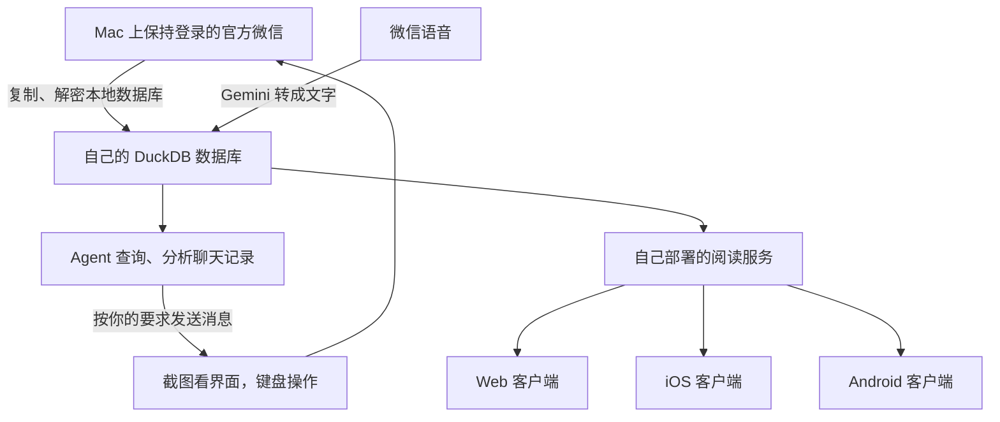

# 怎么样拥有一个无所不能的微信 Agent？

[English](README.md) | **简体中文**

## 为什么要拥有一个微信 Agent？

先看三个你可以直接交给它的任务。

**第一个，帮你找人、发消息。**

> 找到今天和我聊微信自动化的那个人，告诉他：已经跑通了，这条消息就是 Agent 帮我发的。

它先查今天的聊天，确认你说的是谁，再打开微信、找到联系人、输入消息并发送。你交代清楚要找谁、说什么，剩下的操作交给它。

**第二个，帮你找历史记录。**

> 上个月有人给我推荐过一个开源项目，好像是做语音的。帮我找到那条消息和链接。

你不必记住在哪个群、谁发的，或者当时用了哪个关键词。Agent 可以按你记得的线索去查，把相关消息和前后文找出来。语音转成文字以后，也能一起搜索。

**第三个，更有意思：让它围绕人和话题，把不同群里的聊天串起来。**

> 这个群里的 A 和 B 最近聊了些什么？再看看他们在其他群里说过什么，有没有讨论过同一个项目？

它可以先找到这两个人在当前群里的发言，再去查他们在其他群里的记录：各自说了什么、什么时候说的、哪些话题有来回讨论。最后按人、话题和时间整理出来，附上原消息，方便你核对。

只要记录已经进入你的本地档案，理论上就能把这些群一起查，不用你逐个打开、翻聊天记录。这里查的是**你自己的账号能够看到并保存下来的记录**，不包括别人的私聊或你没加入的群。

再往前走一步，你甚至可以给这些数据做一个自己的客户端，在 Web、iPhone、Android 上看同一份微信历史。后面会讲怎么搭。

## 整个系统怎么搭起来

准备一台 Mac，让官方微信一直登录在上面。把它收到的消息整理进本地数据库，交给 Agent 查询；需要发消息时，让 Agent 操作这台 Mac 上的微信。再给数据库接一个服务，你就可以做自己的 Web、iOS 和 Android 客户端。

整个结构是这样的：



**官方微信负责收发，自己的数据库负责保存，Agent 负责查询和操作，自己的客户端负责展示。** 下面就按这个顺序搭。

## 1. 先准备一台保持登录的 Mac

在 Mac 上登录你自己的微信，保持联网，并避免整机休眠。后面的同步和发消息都依赖它。专门留一台机器做这件事会方便一些，因为操作微信时可能需要占用前台窗口。

再准备一个能读本地文件、运行命令和查看截图的 coding agent。我们用的是 Codex。装依赖、写代码、编译工具、搭服务，都可以让它完成；首次登录和系统要求的授权需要你操作。

**先记下版本，再开始。** 微信升级后，数据库和取钥方式可能变化。我们的实测环境是：

| 做的事情 | macOS | 微信 |
| --- | --- | --- |
| 最早跑通取钥和解密 | 26.6.2，Apple Silicon | 4.1.13，build 269579 |
| 后来跑通截图、找人和发消息 | 27.0，build 26A428，Apple Silicon | 4.1.15，build 270102 |

这是实测记录，不是必须安装这些版本。让 Agent 先检查你的环境，再找匹配的工具和方法。

**这里有个保持版本稳定的小技巧：** 可以考虑从 [Mac App Store 下载微信](https://apps.apple.com/us/app/wechat/id836500024?mt=12)，然后打开 **App Store → 设置 → 自动更新**，取消勾选。这样可以自己选择更新时机，减少 App Store 自动升级打断现有流程的情况。[Apple 的设置说明](https://support.apple.com/en-us/102629)

注意，这个开关影响所有 App Store 应用，不只是微信。它控制的是商店更新，不能保证旧版微信永远可用。准备升级时，先检查版本适配并备份档案。这里建议的是让更新更可控；不代表商店版已经通过了上面全部测试。

还有一个要提前处理的事情：**电脑上得先有你想读的历史。** 手机独有的聊天，需要通过微信自己的迁移或同步功能带到电脑。解密只能读出本机已有的数据，不能补出没有下载的消息和附件。

## 2. 把微信的数据库解密出来

微信会把本地数据放在账号目录里。Mac 微信 4.x 的常见位置是：

```text
~/Library/Containers/com.tencent.xinWeChat/Data/Documents/
  xwechat_files/<你的账号目录>/db_storage/
```

里面有很多数据库：聊天消息、联系人、会话、媒体、收藏，各自存在不同的文件里。消息多的时候，还会分成几个库。

这里可以直接让 Agent 做：定位自己的账号目录，列出数据库，先复制一份，再处理副本。复制时要带上旁边的 WAL 文件，里面可能还有已经收到、尚未写回主文件的新消息。**原始数据库不要改。**

接下来是取密钥。我们参考了 [wechat-chat-history-mac](https://github.com/BIBOYANG425/wechat-chat-history-mac) 和 [wechat4-macos-frida-export](https://github.com/TimFang4162/wechat4-macos-frida-export)，再把取钥、解密和校验接进自己的程序。

这一步最依赖版本。让 Agent 去看上游的 README、最近提交和 Issues，确认你的微信版本有没有对应的成功记录，再选择方法。维护者会更新适配，但不能保证每个新版本都立即可用。

我们当初遇到的一个具体问题是 SIP。SIP 是 macOS 的系统完整性保护：当时它开启着，普通权限和管理员权限都无法让 Frida 附加到微信进程；关闭 SIP 后，才成功拿到密钥。**那次关闭 SIP 是为了取钥。已经拿到密钥后，对数据库副本做离线解密不需要再附加微信。**

上游后来提供了使用独立调试副本、保持 SIP 开启的方案。这是上游报告的路径，我们没有在本机复现；它涉及运行微信副本和独立登录，使用前要看清说明。不要把关闭 SIP 当成所有版本都必须执行的固定步骤。具体版本和测试历史放在[验证记录](docs/verification.md)里。

拿到密钥后，把通过验证的密钥缓存在本机。以后同步优先复用，只有缺失或验证失败时才重新取。不同数据库可能用不同的密钥，文件名相同也不保证里面永远是同一个库，所以每次仍要校验。

这一步完成后，让 Agent 告诉你：哪些库解开了，哪些还缺密钥，哪些没有通过完整性检查。主消息库可读，就可以继续做聊天档案；其他库的缺口要保留下来。

## 3. 整理进 DuckDB，把语音也变成文字

解密后的微信数据库仍然是微信自己的结构。再做一层导入，把它整理进本地 **DuckDB**，后面的查询就简单了。

每条消息至少保留这些东西：谁说的、在哪个聊天里、什么时候说的、消息类型、正文，以及原始消息 ID。联系人还要保留备注名、昵称和微信号，避免同名找错人。

导入程序按消息标识去重。以后收到新消息，再同步进来，不需要每次重新导入全部历史。我们的实现是按需同步，执行完就退出；如果你需要定时更新，可以在这条路径稳定以后单独加调度。

### 语音怎么处理

先从媒体数据库里提取音频，再交给 Gemini 转写，把文字写回 DuckDB。语音格式和解码部分可以参考 [WeChatDecrypted](https://github.com/kclx/WeChatDecrypted)；我们用 pilk 处理 SILK 音频，部分其他格式用 ffmpeg。

存储时分开处理：音频原件放在本地文件夹里，数据库保存文件位置、转写文字，以及它对应的消息。

**转写之后，不能丢掉“谁在什么时间说的”。** 比如一条语音转成“周五下午三点见”，必须继续关联原来的发送者、会话和时间，否则 Agent 没法判断是谁约的、约的是哪个周五。

先转十条，核对文字和消息关联，再处理剩下的。成功的结果保存下来，后续查询直接读文字，不必重复调用 Gemini。模型名称按你自己的 API 项目选，参考 [Gemini 音频文档](https://ai.google.dev/gemini-api/docs/audio)。这一步会把音频发给 Gemini。

### 图片、收藏和文章呢

图片先把文件拿到。我们目前能读取普通图片和部分旧式加密图片；新版加密图片还没有统一处理，也没有批量做 OCR。拿到可读图片后，可以让 Agent 按需看图，之后再把识别结果和原消息关联起来。

收藏也有自己的数据库。我们已经解开过收藏主库，但还没有把它完整接进查询工具。后面可以继续做收藏列表、链接和附件的整理。

公众号文章通常要多一步：聊天记录里可能只有标题、链接或分享卡片。拿到链接后，再让浏览器 Agent 打开文章读取。数据库里有一条分享记录，不代表文章全文也已经存好了。

到这里，你已经有了一个可以不断更新的本地微信档案。备份时，把 DuckDB、媒体文件和密钥一起备份到自己的安全位置，别放进公开代码仓库。

## 4. 让 Agent 查你的聊天记录

给 Agent 一组查询命令，再写成 Skill：先更新数据，找到联系人或群，再按时间和关键词取消息，需要时往前后多读几条。

接下来就可以直接问：

> 看看我下周有什么安排，把已经约好和还没确定的分开。

> 最近几个 AI 群里，哪些人经常提供有用的信息？给我看具体例子。

> A 群里的甲和 B 群里的乙，有没有提过同一个项目？他们可能是什么关系？

这一步不一定需要向量数据库。我们先用 DuckDB 查人、查时间、查关键词，再让 Agent 读相关上下文，已经能完成很多问题。

要注意两件事：让它核对同名联系人；让它把消息里明确说过的事和自己的推测分开。回答最好带上日期和原文依据，你才能回去核对。

数据库在本机，查询也在本机执行。如果用的是云端 Agent，取出的聊天片段仍可能进入模型上下文，按你愿意交给模型的范围查询即可。

## 5. 再让 Agent 帮你发消息

发消息走桌面操作。我们写了两个很小的 Swift 程序：一个用 ScreenCaptureKit 截取微信画面，另一个向微信发送键盘操作。

Agent 把它们组合起来，做的事情和你自己操作差不多：

```text
把微信切到前台
  → 打开搜索，输入联系人名字
  → 看搜索结果，选中正确的人
  → 打开聊天，核对标题和上下文
  → 输入消息，检查内容
  → 回车发送，再看是否出现新消息
```

顺序由 Agent 根据截图决定。Swift 工具只提供截图、搜索快捷键、输入、回车、方向键等基础动作；换个联系人、换段文字，不需要重写代码。增加鼠标点击或滚动等新能力时，再扩展工具。

这部分已经整理成仓库里的 [wechat-desktop Skill](skills/wechat-desktop/SKILL.md)，Swift 源码和构建脚本都在里面。让 Agent 读取这个 Skill，按[安装说明](skills/wechat-desktop/references/setup.md)编译即可。

首次需要两项 macOS 权限：**屏幕录制**让它看到微信，**辅助功能**让它发送按键。它们和取钥时遇到的 SIP 问题是不同的事情。我们发送测试时没有调整 SIP，不过测试机器当时仍关闭着 SIP，尚未单独验证开启 SIP 的完整发送过程。

有两个实际踩过的坑值得记住。

第一个是焦点。给后台微信发送快捷键后，搜索框没有出现可确认的变化；把微信切到前台后就跑通了。所以当前方案需要一个可操作的桌面，不能假定锁屏、休眠或没有显示器时也能照常发。

第二个是截图范围。只截微信主窗口，有时看不到搜索下拉框，因为它属于另一个窗口。工具因此增加了同一个应用的窗口合成截图。之前遇到过的白屏，在后来的测试里没有复现，不能把它简单归结为微信禁止截图。

第一次先给自己发一条测试消息。跑通后，再让它发给指定联系人。我们已经完成了这两种测试。

发送时留下三个检查点就够了：**选对人、文字正确、发送后看结果。** 原输入框有草稿时别覆盖；没有看清是否发出时，先查证，别直接再发一遍。

## 6. 最酷的一步：做一个自己的微信客户端

现在，你有了自己的消息数据库。给它接上一个服务，就能在任何能访问这个服务的设备上看聊天记录。

我们选了开源聊天项目 [Tinode](https://github.com/tinode/chat)。它已有服务端和聊天界面，省掉了从头写登录页、会话列表和消息列表的工作。在它的基础上，把微信档案接进去，再改成自己喜欢的样式。

这一部分可以分三步做。

### 先让 Web 跑起来

DuckDB 继续保存原始档案，另外把需要展示的数据导入 Tinode 使用的 PostgreSQL：

```text
DuckDB 里的微信历史
  → 导入展示数据库
  → Tinode 服务端
  → 浏览器里的聊天界面
```

每个微信会话对应一个历史聊天，消息保留原发送者和时间。语音已经转成文字，可以直接在列表里读。

先做只读最省事：能登录、能找到聊天、能翻历史就够了。前端去掉输入框，服务端也拒绝写消息。我们目前的客户端就是这个范围，原始图片附件和语音播放还没有接进去。

新消息的更新顺序也很明确：Mac 微信收到消息，档案程序同步进 DuckDB，再导入展示服务。客户端看到的是这份展示数据，所以更新速度取决于你怎样运行同步。

### 再给它一个自己的地址

我们用了 Tailscale。Mac 和手机加入同一个私人网络，把本机阅读服务通过 Tailscale Serve 提供成 HTTPS 地址，手机就能打开。

这样可以先不用把聊天服务暴露到公网。给服务设置自己的账号密码，客户端使用自己的地址。Mac 关机、休眠或服务停止时，远端也就访问不到了。[Tailscale Serve 配置说明](https://tailscale.com/kb/1242/tailscale-serve)

### 最后做成 iOS 和 Android App

Web 跑通以后，我们用 Capacitor 把同一套界面打包到 iOS 和 Android。三端共用后端，也共用大部分界面代码。

Android 可以先构建测试 APK 安装。iOS 使用自己的 Apple 开发者账号，创建 App ID 和 App Store Connect 记录，配置签名，上传到 TestFlight。证书和上传步骤可以让 Agent 协助处理，需要账号授权的地方由你完成。

我们已经构建了 Android 测试包，完成 iOS 和 Android 模拟器上的登录、打开聊天、滚动测试，也把 iOS 版本送进了私人 TestFlight。

**这些 App 登录的是你自己的服务。它们不会再各自占用一个微信官方客户端的登录名额。** 官方微信仍然只在那台 Mac 上接收消息，你可以在其他手机、平板和电脑上打开自己的客户端，读同一份历史。能接多少设备，主要看自己的服务容量和访问设置。

界面也由你决定。可以把语音直接显示成文字，可以给某几个群单独做一个页面，也可以在聊天旁边加“总结最近一周”的按钮。后面这些功能都可以围绕同一个数据库继续做，不需要每次重新解决消息从哪里来的问题。

至于从自己的 App 直接发微信，还需要把客户端的发送请求接到 Mac 上的执行工具，处理收件人、任务排队和发送结果。**我们目前还没有接这一步：自建客户端只读，发消息由 Mac 上的 Agent 完成。** 两边已经分别跑通，接下来要做的是把它们可靠地连起来，尤其避免超时重试造成重复发送。

## 从哪里开始

把这篇文章和仓库地址交给你的 Agent，先让它检查机器和微信版本。按“本地档案 → 查询 → 桌面发送 → 自建客户端”的顺序，一步跑通再往下做。

目前仓库已经放入可以独立安装的[桌面操作 Skill 和 Swift 工具](skills/wechat-desktop/SKILL.md)。档案、阅读服务和移动客户端已在本机原型中运行，通用化源码还在整理，尚未包含在这个仓库里。

- [安装桌面操作 Skill](skills/wechat-desktop/references/setup.md)
- [交给 Agent 的分阶段提示](docs/agent-prompts.md)
- [原型的命令、依赖和数据处理细节](docs/prototype-workflow.md)
- [实测版本、SIP 历史和验证范围](docs/verification.md)
- [后续配套源码计划](docs/source-plan.md)

Happy Hacking!
